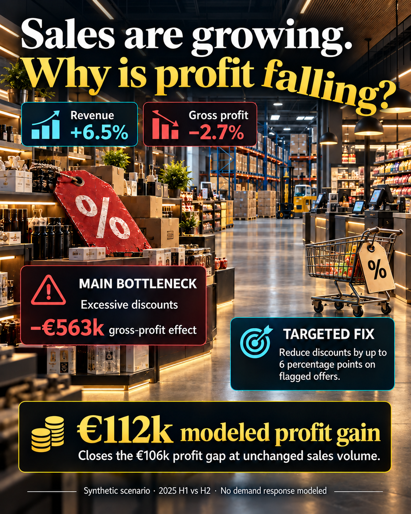

# Retail Margin Leak & Action Engine

**Sales are growing. Why is profit falling?**

A reproducible Python and SQL project that explains retail gross-profit erosion and turns it into targeted, inspectable pricing actions. Includes a local interactive dashboard, a fixed-volume policy replay, and a visual explanation.



**All data is synthetic.** This project demonstrates a controlled scenario, not results delivered for a real company. Accounting attribution identifies financial drivers; it does not establish causal demand effects.

## The business question

An omnichannel retailer is selling more but earning less gross profit. Which factors explain the change, where is the issue concentrated, and which offers should commercial teams investigate or test?

The analysis compares H1 and H2 2025 across **500 products, 180,000 sales lines, 60,000 orders, five categories, three regions and two channels**.

## What the analysis found

| Metric | H1 2025 | H2 2025 | Change |
| --- | ---: | ---: | ---: |
| Revenue after discounts | €11.76m | €12.52m | +6.46% |
| Gross profit | €3.91m | €3.81m | −2.71% |
| Gross margin | 33.27% | 30.40% | −2.86 pp |

Discount changes are the largest negative accounting driver: **−€563k**. Volume and list-price changes partly offset that pressure. The exact five-factor bridge reconciles the total **−€106,089.36** GP change to within one cent.

### The targeted solution

The policy reduces discount depth by **up to six percentage points** on flagged SKU / region / channel offers—for example, from 20% to 14%. Each revised selling price is capped at its list price.

Replaying the policy on the same sales quantities adds **€112,241.30 in modeled gross profit**, enough to close the **€106,089.36** baseline GP gap. The calculation is performed on individual sale lines, with whole-cent rounding.

This is a fixed-volume scenario, not forecast recovery. A uniform unit decline of approximately **1.14% on affected offers** would exhaust the headroom above H1 GP. A controlled commercial test is still needed to measure demand response.

## Tools

| Tool | Role |
| --- | --- |
| Python | Seeded data generation, exact Shapley bridge, action rules, policy replay and evaluation |
| SQLite / SQL | Six-table model, as-of cost joins, line financial calculations and KPI queries |
| Matplotlib | Data-derived analytical chart and vector export |
| HTML / CSS / JavaScript | Offline dashboard with category / region / channel filters and action drill-down |
| ImageGen | Reviewed solution illustration; exact analytical numbers and assumptions are retained |
| GitHub Actions | Reproduction and validation workflow |

## Run locally

Use Python 3.9–3.12. Python 3.12 is selected for CI. The only non-standard Python dependency is Matplotlib and its dependencies. Node 18+ is needed only for the JavaScript checks.

```sh
python3 -m venv .venv
source .venv/bin/activate
python -m pip install -r requirements.txt
python run.py
python -m unittest discover -s . -p 'test_*.py' -v
node test_dashboard.js
```

On Windows, activate the environment with `.venv\Scripts\activate`.

Open **[dashboard/dist/index.html](dashboard/dist/index.html)** in your browser after running the project. A default-data dashboard bundle is included, so it can also be opened before generation. It uses local scripts and data, with no API, account or server requirement. GitHub displays HTML source; download or clone the repo to use the interactive dashboard locally.

For an existing, checksummed dataset, `python run.py --skip-generate` reuses the CSVs. A full run regenerates data and refreshes numerical outputs, the code-native visual and the English post. The cinematic illustration is a retained asset and is not regenerated by Python.

## Repository guide

```text
.
├── generate.py              # Controlled synthetic retail environment
├── analyze.py               # SQL metrics and actionable diagnostics
├── bridge.py                # Exact five-factor attribution
├── discount_solution.py     # Line-level discount policy and sensitivity
├── evaluate.py              # Separate planted-pattern evaluation
├── visuals.py               # Analytical figure and post
├── build_dashboard.py       # Offline dashboard bundle
├── run.py                   # Reproduce the complete project
├── sql/                     # Schema, financial view and KPI queries
├── dashboard/               # Interactive visual tool and built bundle
├── assets/                  # Final solution illustration and provenance
├── data/                    # Generated CSVs (ignored) and manifest
├── examples/                # Small, view-only source sample
├── outputs/                 # Computed report, exports and analytical plot
├── validation/              # Planted labels and evaluation results
├── docs/                    # Business, data and methodology contracts
└── .github/workflows/       # Reproduction checks
```

Start with [the business brief](docs/project-brief.md), [data model](docs/data-model.md) and [KPI / attribution contract](docs/methodology.md). See [the targeted solution](docs/discount-solution.md), [primary research](docs/research.md), [visual provenance](docs/visual-generation.md) and [project glossary](GLOSSARY.md) for the details.

## Validation

- Ten data-integrity checks, including effective-dated costs, promotion eligibility and stock consistency.
- Exact reconciliation for all **72** dashboard scopes.
- Eight Python tests, including an independent check against all **120** replacement orders.
- JavaScript checks for scope filters, search, action filtering, monthly totals and KPI reconciliation.
- Five planted patterns evaluated separately after analysis; the analyzer does not read planted labels.

Cost flags match all 50 planted SKUs. Discount flags include all 40 planted SKUs among 125 flagged SKUs: a **32% planted-label match fraction**, so the queue is deliberately reviewable rather than an autonomous decision maker. Labels are not exhaustive ground truth about every economic concern.

## Interpretation limits

Gross profit is sales after discounts minus modeled product COGS. VAT, returns, shrinkage, fulfilment, marketing and overhead are excluded. H1/H2 differences include seasonality and unequal day counts. Snapshot stock is not a measure of lost demand. Joint mix means SKU × region × channel, and category-local factor effects should not be summed into company factors.

No causal uplift, elasticity model, forecast, automated price change or cloud deployment is claimed. The dashboard's numerical model and asset packaging are checked; browser rendering and click-through have not been visually verified in this environment.

